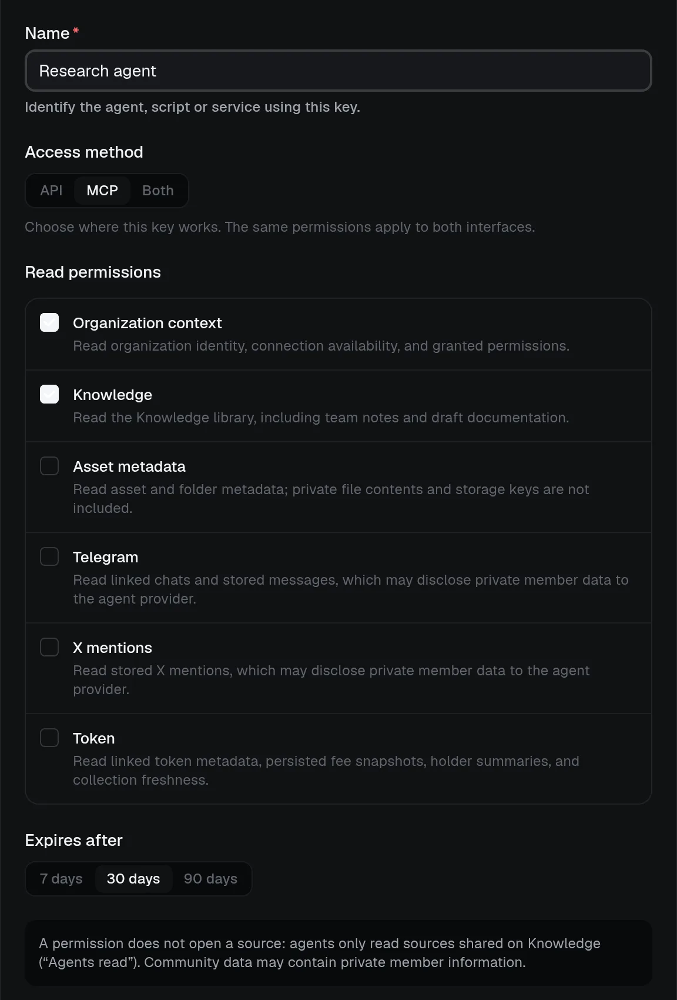

# Credentials and keys

## Create a credential

:::steps

### Create the key

On the **Developers** page, an owner or admin creates a named key for one workspace. The same page shows the address and a first request for MCP or the API, and how often agents have read the workspace.

### Choose methods, scopes and expiry

Enable **API**, **MCP** or both, choose only the needed read scopes and select a 7-, 30- or 90-day expiry. Previously issued API keys remain API-only.

### Copy the secret

Copy the secret when it appears; Claire retains a hash, not a recoverable copy. Revoke it when no longer needed. Changing its methods or scopes requires explicit manager approval and does not rotate the secret or expiry.
:::

> [!WARNING]
> Store the key in your server environment or agent's secret store, never in browser code, a public variable, a skill file or source control. A key stops working if its issuer loses owner or admin membership.

## Next steps

:::cards
::card[Scopes and source sharing]{href=scopes.md icon=shield}
Approve the sources the key may read.
::card[Context and search]{href=context-and-search.md icon=search}
Make your first request.
:::
