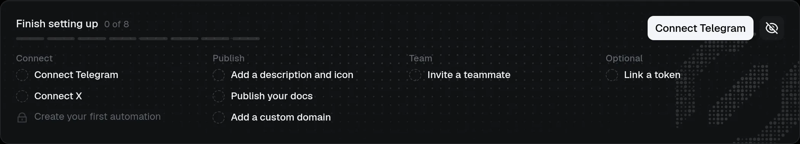

# Getting started

Your personal space and project workspaces are separate. Personal navigation contains your Home, Referrals, Wallet, [$CLAIRE](../claire/index.md) and account settings. A project's sidebar starts with Home, Token, Community (Telegram), Social (X) and People; then Knowledge, Automations and Developers; then Assets; and Settings last. Create or choose a workspace for your project. You do not need to link a token to use Telegram, X, or Knowledge.

## Create a workspace

:::steps

### Create it

Sign in and create a workspace with a name and unique slug.

### Choose it

Choose it from your workspace list. The creator becomes its owner.
:::

Owners and admins can use the optional **Getting started** sidebar checklist. Hide or restore it for the selected project in **Personal settings → Appearance**; the preference applies to your account in this browser.

Claire uses a dark interface. Appearance offers preset or custom accent colours for this browser, not an account-wide theme.

## Invite teammates

:::steps

### Invite by email

In **Settings → Members**, invite teammates by email. Owners and admins can send invitations.

### Share the link if needed

Share the invitation link if email delivery is not configured or the email was not sent. Claire creates the link and attempts to email it when delivery is configured.
:::

Invitation links expire after 7 days. Access to workspace data depends on current membership, not simply having a link.

## Understand roles

| Role | What it can do |
| --- | --- |
| Owner | Manage the workspace, change other members' roles, and transfer ownership. |
| Admin | Manage integrations and content, invite people, and create developer keys. |
| Member | View the workspace and its connected activity; management actions are restricted. |

Only the owner changes another member's role.

## Choose your next step

You can do these in any order.

:::cards{cols=3}
::card[Link a Telegram chat]{href=../sources/telegram.md#link-a-chat icon=telegram}
Follow your community's messages and people.
::card[Connect X]{href=../sources/x.md#connect-an-account icon=x}
Inspect an account's collected activity.
::card[Control what agents can read]{href=../sources/context.md#decide-what-to-include icon=lock}
Choose which sources Claire uses and which agents may read.
:::

For optional token tools, [verify a wallet and launch or vest a supported token](../sources/token-actions/signing-wallet.md) when your chosen network is available.

Want to know who can see what? Read [Security and data](security-and-data.md).

Building a server or agent integration? An owner or admin can [create a developer credential](../api/index.md) for REST, MCP, or both, then approve the sources it may read.
