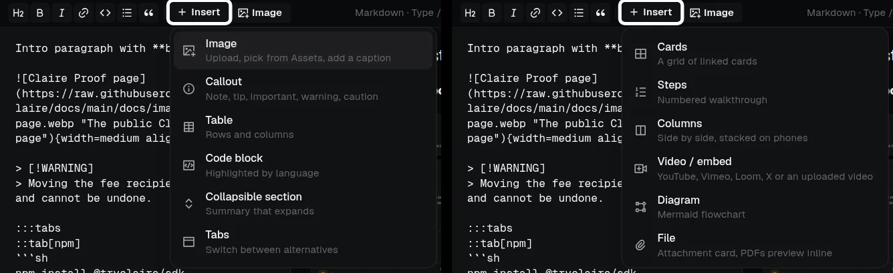
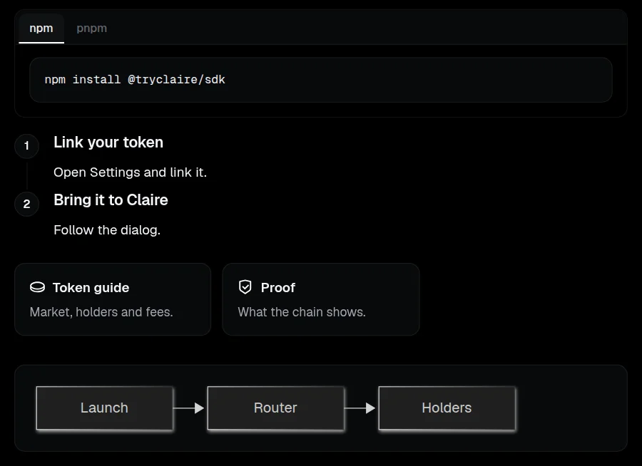
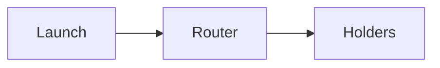

# Publishing

Set up a public profile and publish docs from Claire or a GitHub repository. Your site's profile and docs use your workspace slug unless you connect a custom domain.

## Set up your public site

1. In Site, set your project's public profile, logo, and accent.
2. Publish pages in **Docs** to make them visible in your site's docs section.
3. Optionally connect a custom domain for the profile or docs. A profile domain serves docs at `/docs`; a dedicated docs domain serves them at its root. Custom domains are included for the first 50 projects that connect one; after that, connecting a domain requires the top plan. A project that already has a domain can keep adding more.

New docs pages start as private unpublished drafts. A **public reference** classification or external read access does not publish a page. Review and publish a page in **Docs** deliberately. This does **not** change GitHub Site sync: imported pages still publish immediately.

## Sync docs from GitHub

### Public repository

1. In **Docs**, paste the GitHub URL or `owner/repo`.
2. Select a branch and optional folder.

### Private repository

1. Install the Claire GitHub App and give it access to the repository. The app's access to repository contents is read-only.
2. In Claire, select that installation's repository, branch, and folder.

A push changing the selected folder triggers a re-sync. You can also request a sync manually. If sync fails, the saved connection and error remain visible. Edit GitHub-backed pages in GitHub, not in the Claire editor.

> [!WARNING]
> Synced docs and copied images are public, even when the source repository is private. Do not sync confidential text or images.

## Organize imported pages

Place `.md` files in the selected folder. Optional frontmatter `title` and `order` set page titles and navigation order. An `index.md` or `README.md` leads its folder; relative links to other `.md` files become docs page links.

Keep relative images inside the repository. During private repository sync, Claire copies them into workspace storage and serves them at public file URLs. GitHub-imported pages publish immediately on sync. See [current limits](../reference/index.md) for import and storage bounds.

## Rich content

Docs pages are plain Markdown with a few extra blocks. The Claire editor stays a Markdown editor with a live preview, and an **Insert** menu adds the blocks for you. Pages synced from GitHub use the same syntax, so everything below also works in your repository's `.md` files. GitHub's own preview does not know the extra blocks and shows them as plain text; Claire renders them. Anything it does not recognize renders as ordinary Markdown.





### Insert menu and slash commands

In **Docs**, the formatting bar has an **Insert** menu next to the existing toolbar buttons. You can also type `/` at the start of an empty line. Both open the same list of blocks:

- Arrow keys move through the list, Enter inserts the highlighted block, and Esc closes it.
- With `/`, keep typing to filter the list, for example `/tab`.
- Blocks that need input open a small dialog first: image options, callout type, table size, code language, tab labels and the embed URL. The rest insert immediately.
- Images and files can be uploaded, pasted, dropped on the editor or picked from **Assets**.

The inserted text is ordinary Markdown that you can edit by hand. The sections below show the syntax for each block.

### Images

````markdown


{width=medium align=center}
````

A plain image is unchanged. A quoted title becomes a caption under the image. The optional `{…}` block sets `width` (`small`, `medium` or `full`) and `align` (`left`, `center` or `right`). Always write alt text. On a public docs site, clicking an image opens it larger; Esc closes it.

To show different images in light and dark mode, add GitHub's fragments. Claire's docs are dark, so the `#gh-light-mode-only` image is hidden and the `#gh-dark-mode-only` image is shown, without the fragment:

````markdown


````

### Callouts

````markdown
> [!NOTE]
> Background information.
````

The types are `NOTE`, `TIP`, `IMPORTANT`, `WARNING` and `CAUTION`.

### Tables

````markdown
| Plan | Seats |
| --- | --- |
| Free | 1 |
| Team | 10 |
````

The Insert menu creates 1 to 8 columns and 1 to 20 rows.

### Code blocks

````markdown
```ts
const answer = 42;
```
````

The language after the opening fence selects syntax highlighting. An unknown or missing language renders as plain text.

### Collapsible sections

````markdown
:::details[Show the fine print]
Hidden until the reader expands it.
:::
````

### Tabs

````markdown
:::tabs
::tab[npm]
```sh
npm install @tryclaire/sdk
```
::tab[pnpm]
```sh
pnpm add @tryclaire/sdk
```
:::
````

Each `::tab[Label]` line starts a tab, and everything until the next one is its content. Tabs scroll sideways on narrow screens.

### Cards

````markdown
:::cards
::card[Token guide]{href=/docs/token icon=coin}
Market, holders and fees.
::card[Proof]{href=/docs/proof icon=shield}
What the chain shows.
:::
````

`::card[Title]` starts a card and the lines below it are its text. `href` makes the title a link: `/…` paths and full URLs are used as written, and a relative path such as `token.md` resolves like any other docs link. A card without `href` is not linked. `icon` is optional. The supported icons are `book`, `chat`, `code`, `coin`, `file`, `bolt`, `image`, `idea`, `link`, `question`, `rocket`, `settings`, `shield`, `star`, `terminal` and `video`; an unknown name shows no icon. Cards stack on narrow screens.

### Steps

````markdown
:::steps
### Link your token
Open Settings and link it.
### Bring it to Claire
Follow the dialog.
:::
````

Every `###` heading inside the block starts a numbered step. Text before the first heading stays plain.

### Columns

````markdown
:::columns
::column
Left column.
::column
Right column.
:::
````

Columns sit side by side and stack below 768 px.

Tabs, cards, steps, columns and collapsible sections can be nested one level deep, for example a code block or steps inside a tab. A block that is not closed with `:::`, or nested deeper than that, renders as ordinary text.

### Video and embeds

````markdown
::embed{url=https://www.youtube.com/watch?v=dQw4w9WgXcQ}

https://vimeo.com/76979871
````

Put the URL in `::embed{url=…}`, or paste a supported URL alone on its own line. Embeds are responsive 16:9 players in a sandboxed frame. Only these sources are embedded:

- YouTube (`youtube.com`, `youtu.be`), played from `youtube-nocookie.com`.
- Vimeo.
- Loom share links.
- X (Twitter) post links.
- MP4 or WebM videos uploaded to **Assets**, played with the browser's native controls.

Any other `http` or `https` URL becomes a link card that shows the host and opens the page. Other schemes are shown as text.

### Files

````markdown
::file{url=/files/a/00000000-0000-0000-0000-000000000000/whitepaper.pdf name="Whitepaper" size="1.2 MB"}
````

A file renders as an attachment card with an icon for its type, its name and the optional size. Clicking it opens the file in a new tab; images and videos display there, and other types such as PDFs and zips are saved by the browser. Use a file uploaded in **Assets** (the **File** insert picks or uploads one and fills in the URL); an external `https` URL renders as a card only.

### Mermaid diagrams

````markdown

````

A `mermaid` code block renders as a diagram on your public docs site and in the editor preview, in a dark theme that matches the docs. If the diagram cannot be drawn, the source stays visible instead.

### Search and sync

Docs search indexes image captions, tab labels, card titles, collapsible summaries and file names. Embed URLs are not indexed. For GitHub-synced pages, write the blocks in the `.md` files in your repository. Uploaded videos and files are served from workspace storage, so use the URL of a file uploaded in **Assets** for those.
