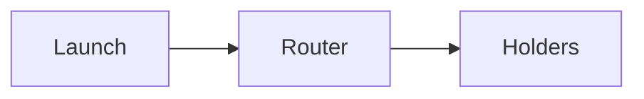

# Media and diagrams

Blocks for video, attachments and diagrams.

## Video and embeds

````markdown
::embed{url=https://www.youtube.com/watch?v=dQw4w9WgXcQ}

https://vimeo.com/76979871
````

Put the URL in `::embed{url=…}`, or paste a supported URL alone on its own line. Embeds are responsive 16:9 players in a sandboxed frame. Only these sources are embedded:

- YouTube (`youtube.com`, `youtu.be`), played from `youtube-nocookie.com`.
- Vimeo.
- Loom share links.
- X (Twitter) post links.
- MP4 or WebM videos uploaded to **Assets**, played with the browser's native controls.

Any other `http` or `https` URL becomes a link card that shows the host and opens the page. Other schemes are shown as text.

## Files

````markdown
::file{url=/files/a/00000000-0000-0000-0000-000000000000/whitepaper.pdf name="Whitepaper" size="1.2 MB"}
````

A file renders as an attachment card with an icon for its type, its name and the optional size. Clicking it opens the file in a new tab; images and videos display there, and other types such as PDFs and zips are saved by the browser. Use a file uploaded in **Assets** (the **File** insert picks or uploads one and fills in the URL); an external `https` URL renders as a card only.

## Mermaid diagrams

````markdown

````

A `mermaid` code block renders as a diagram on your public docs site and in the editor preview, in a dark theme that matches the docs. If the diagram cannot be drawn, the source stays visible instead.
