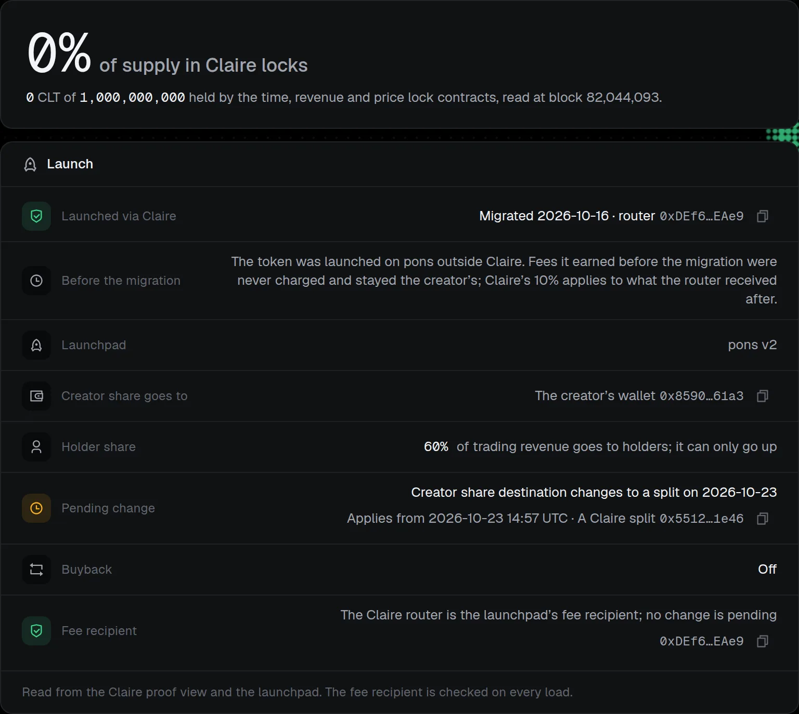
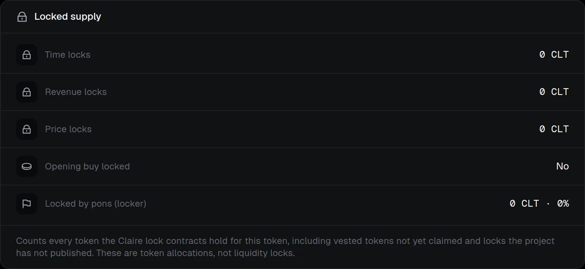

# Claire Proof

Every supported token has a public **Claire Proof** page at `/proof/<chainId>/<token>`. It needs no sign-in, and it resolves for any ERC-20 on a supported network, not only tokens launched through Claire. Its open-graph image and the badge below use the same data.

> [!NOTE]
> **Evidence, not endorsement.** The page states what the chain and Claire's records show. It says nothing about the token's value, the project's intentions or what happens next, and it is not an audit or a liquidity-lock guarantee.



## What it shows

The header names the token and network and reads **Launched through Claire** or **Not launched through Claire**. Then:

- **Locked share:** the percentage of total supply held by the Claire time, revenue and price lock contracts, with the amounts, read in one call at one stated block. It counts every token those contracts hold for this token, including vested but unclaimed tokens and locks the project has not published. These are token allocations, not liquidity locks.
- **Launch** (Claire-launched tokens only): the router, the launchpad, who receives the creator share (the creator's wallet, a Claire vesting vault, a Claire split, or a contract Claire's vault factory did not make) and, when the creator has announced a change, the pending recipient and the date it can take effect, the holder share (current; it can only go up), the buyback state on pons, and the **fee recipient**. The fee recipient is re-read on every load: the page says whether the Claire router is the launchpad's recipient with no change pending, or shows a warning when a change is pending or the launchpad pays someone else.
- **Locked supply:** time, revenue and price lock amounts, each linked to its contract on the explorer; whether the opening buy was locked (from the confirmed launch receipt, with a link to the lock); the supply pons' locker holds on pons; and links to each lock the project has published.
- **Revenue** (Claire-launched tokens only): per asset, what the router has counted as revenue on-chain and the cumulative total confirmed holder rounds have published to holders, with each round's manifest and transaction. A manifest's keccak-256 is the round's on-chain evidence.
- **Verified connections:** the X account, Telegram chat and domain the project connected inside Claire. These are made in Claire, are not on-chain facts and do not show who controls the token.
- **Verify it yourself:** a copyable `@tryclaire/sdk/protocol` snippet that reads the same facts from the chain, and a link to [Verify on-chain](../../verification/index.md). Take contract addresses from the SDK's `deployments` map, never from the page.



For a token that is not registered by a Claire router factory the page states nothing about its launch, fee routing or revenue, and shows only its Claire locks. If the chain cannot be read, the page says so instead of showing figures.

## Badge and sharing


`/proof/<chainId>/<token>/badge.svg` is a small static dark badge (320 px wide, no script or fonts) showing **Launched via Claire** (Yes or No), **Locked by Claire locks** (a percentage) and, for Claire-launched tokens, **Revenue routed**. It is cached for about five minutes. The proof page's **Share this proof** card shows it with copy buttons for these snippets (shown with a placeholder URL):

```text
[](https://<claire-app>/proof/<chainId>/<token>)
<a href="https://<claire-app>/proof/<chainId>/<token>">/proof/<chainId>/<token>/badge.svg" alt="Claire Proof for SYMBOL" width="320"></a>
```

On the **Token** page, everyone sees a **Claire Proof** card that opens the public page, and owners and admins also see a **Share proof** card that opens the badge with the Markdown and HTML snippets.

## For agents and scripts

The same facts are available to an agent or script through the [developer API and MCP](../../api/claire-proof.md#read-the-claire-proof).
