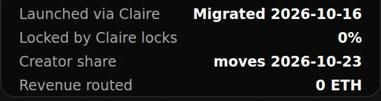

# Claire Proof

Claire Proof is what the chain and Claire's records show about your token. It is shown on your project's public site, in the token card's **On-chain** section, so visitors find it next to the market and your project. No sign-in is needed. The site is served at `/sites/<your-slug>` on the Claire app domain, or on your [custom domain](../../publishing/site-and-domains.md) if you connect one.

> [!NOTE]
> **Evidence, not endorsement.** Claire Proof states what the chain and Claire's records show. It says nothing about the token's value, the project's intentions or what happens next, and it is not an audit or a liquidity-lock guarantee.

## What it shows

The **On-chain** section reads **Launched through Claire**, **Migrated to Claire {date}** or **Not launched through Claire**. Then:

- **Holder share** (Claire-launched tokens only): the share of trading revenue paid to holders. It is the current value and can only go up.
- **Creator share goes to** (Claire-launched tokens only): the creator's wallet, a Claire vesting vault, a Claire split, or another contract.
- **Locked in Claire locks:** the percentage of total supply held by the Claire time, revenue and price lock contracts, read in one call. It counts every token those contracts hold for this token, including vested but unclaimed tokens and locks the project has not published. These are token allocations, not liquidity locks.
- **Revenue routed** and **Paid to holders** (Claire-launched tokens only): what the router has counted as revenue on-chain, and the cumulative total that confirmed holder rounds have published to holders, with the number of rounds.
- **Notices:** a pending creator share change, with the date it can take effect, and a warning when the launchpad no longer pays the token's creator fees to its Claire fee router. The fee recipient is checked on every read.
- The network and block the facts were read at, and a link to [Verify on-chain](../../verification/token-proof.md).

Below the token card, **Locked supply** lists the locks the project has published, each read on-chain: amount, how much has unlocked and been claimed, status and dates. Each lock opens its own lock page with the full schedule and on-chain details.

For a token that is not registered by a Claire router factory, the site states nothing about its launch, fee routing or revenue and shows only its Claire locks. If the chain cannot be read, it says so instead of showing figures.

## Permalink

`/proof/<chainId>/<token>` is the token's permanent link. It opens the public site of the project that linked the token, so it keeps working if the project changes its slug or domain.

## Badge and sharing



`/proof/<chainId>/<token>/badge.svg` is a small static dark badge (320 px wide, no script or fonts) showing **Launched via Claire** (Yes or No), **Locked by Claire locks** (a percentage), **Creator share** when a change is pending and, for Claire-launched tokens, **Revenue routed**. It is cached for about five minutes. On the **Token** page, **Share badge** shows it with copy buttons for these snippets (shown with a placeholder URL). Both link to the permalink:

```text
[](https://<claire-app>/proof/<chainId>/<token>)
<a href="https://<claire-app>/proof/<chainId>/<token>">/proof/<chainId>/<token>/badge.svg" alt="Claire Proof for SYMBOL" width="320"></a>
```

**Public site**, next to it, opens your site.

## For agents and scripts

The full set of facts, including the launchpad, buyback state, opening-buy lock, pons locker supply and each round's manifest, is available to an agent or script through the [developer API and MCP](../../api/claire-proof.md#read-the-claire-proof). To check any figure yourself, see [Verify on-chain](../../verification/token-proof.md).
