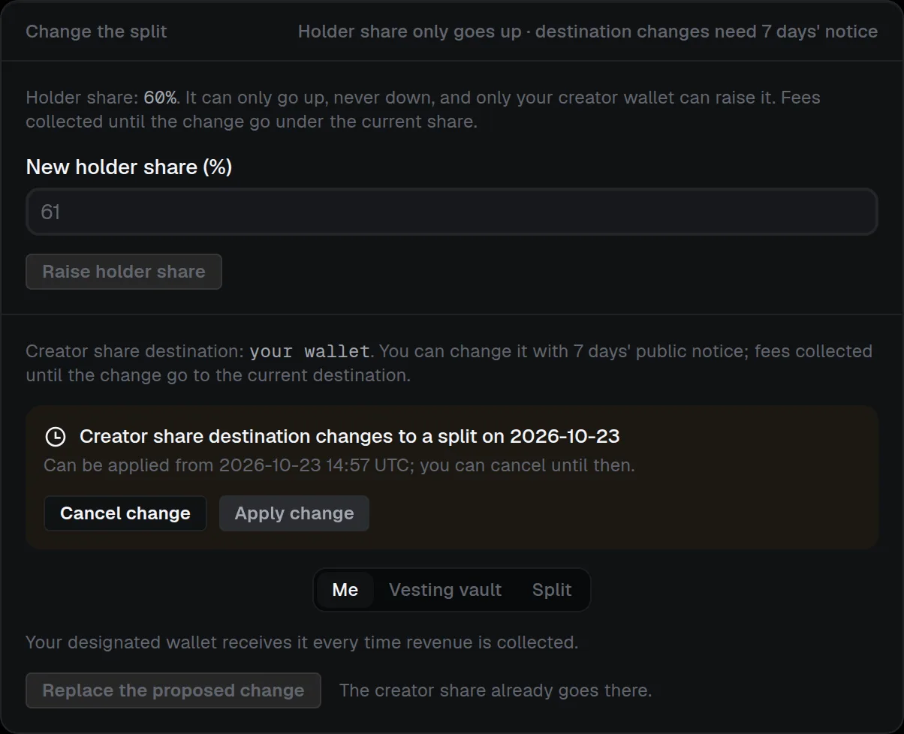

# Creator share and split

The wallet that launches is the **launcher** (the router's `creator`): the only wallet that can launch, switch the buyback or publish the project's holder rounds. The **payee** is who receives the creator share of every distribution. It starts as the one you chose when the router was deployed, and the launcher can [change it with 7 days' public notice](creator-share-and-split.md#change-the-split-after-launch). The launcher keeps no claim on revenue once another payee is set. Opening-buy tokens and launch change always go to (or are locked for) the launcher.

## Choose who is paid

- **Me:** the payee is the launcher.
- **Vesting vault:** a contract that vests everything it receives to one beneficiary. Enter the beneficiary and a start, an optional cliff and an end in UTC. Nothing is released before the cliff; from the start the vested share grows linearly until the end, and everything is released from the end. It takes any token and ETH, and late deposits vest from the start. Anyone can trigger **Release**, which pays only the beneficiary.
- **Split:** a contract that divides everything it receives between 2 to 10 wallets by fixed percentages that must total exactly 100%. Anyone can trigger **Release**, which pays only those wallets. A wallet that rejects its payout is skipped and keeps its share without blocking the others; rounding remainders join the next release.

A vault or split has no owner, admin, upgrade, cancel or transfer, and Claire's vault factory records it so anyone can [verify](../../verification/payee.md#verify-the-payee) that a router's payee is genuine. On **Creator fees**, the vault or split card shows what is vested, released and ready to release per asset, and **Deferred payouts** lists a payout the router could not deliver, which anyone can retry with **Push to payee**.

## Change the split after launch

Every Claire fee router lets its launcher (the router's `creator`, the designated wallet that launched or migrated the token) change two things after launch, from the **Change the split** card on **Creator fees** ("Holder share only goes up · destination changes need 7 days' notice"). Nobody else can start either change, and the rest of the split is fixed: Claire's 10% stays, and nobody can take the token out of Claire, because the router never moves the launchpad's creator-fee recipient.

| | Raise the holder share | Change the creator share destination |
| --- | --- | --- |
| Who starts it | The launcher only | The launcher only |
| When it takes effect | At once | After a 7-day public notice |
| Limits | Up to 90%; it can never be lowered | **Me**, a **Vesting vault** or a **Split** |
| Undo | Not possible | **Cancel change**, any time before it takes effect |
| Applies to | Fees collected after the change | Fees collected after the change is applied |

:::tabs
::tab[Raise the holder share]
Enter the **New holder share (%)** (up to 90%) and select **Raise holder share**, then sign. It takes effect at once. The holder share can only go up: it can never be lowered, so holders can rely on the share they see. Fees the router has earned so far are distributed under the old share first, so the new share applies only to fees collected after the change. You can start from 0%: every router has a holder distributor from the start.
::tab[Change the creator share destination]
Under **Creator share goes to**, choose **Me**, **Vesting vault** or **Split** (a [vault or split](creator-share-and-split.md#choose-who-is-paid) is deployed first with **1. Deploy vesting vault** or **1. Deploy split**), then select **Change creator share destination** and sign. The change is public from that moment and takes effect only after a **7-day notice**. Until then the current recipient keeps being paid. While a change is pending the button reads **Replace the proposed change**, which restarts the 7 days. **Cancel change** withdraws it at any time before it takes effect. When the notice has passed, anyone can select **Apply change**, and the first distribution after it goes to the new recipient. Anything the old recipient was already owed stays theirs.
:::

> [!WARNING]
> The holder share can only go up. A destination change is public from the moment you sign it, and **Replace the proposed change** restarts the 7-day notice.

### Where the notice is shown

The notice is shown publicly, as "Creator share destination changes to {address, a vesting vault or a split} on {date}":

- on the **Token** page, with a link to **Creator fees**;
- on the public site's token card, in Claire Proof's **On-chain** section;
- on the Proof badge, as the row "Creator share · moves {date}".

Owners and admins can also turn on the **Creator share change** notification, sent when a proposal or an applied change confirms. The router carries the notice on-chain too (`pendingPayee` and `payeeChangeAt`), and the fee log lists "Holder share raise" and "Creator share destination change" transactions. Anyone can [verify](../../verification/launch-and-router.md#verify-a-launch) that a router's current holder share and recipient follow only from these public changes.

> [!NOTE]
> **Check the recipient before you rely on it.** A new recipient is only as trustworthy as what it is. A Claire vesting vault or split is recorded by Claire's vault factory and can be verified; an account or another contract can do anything with the funds it receives.
