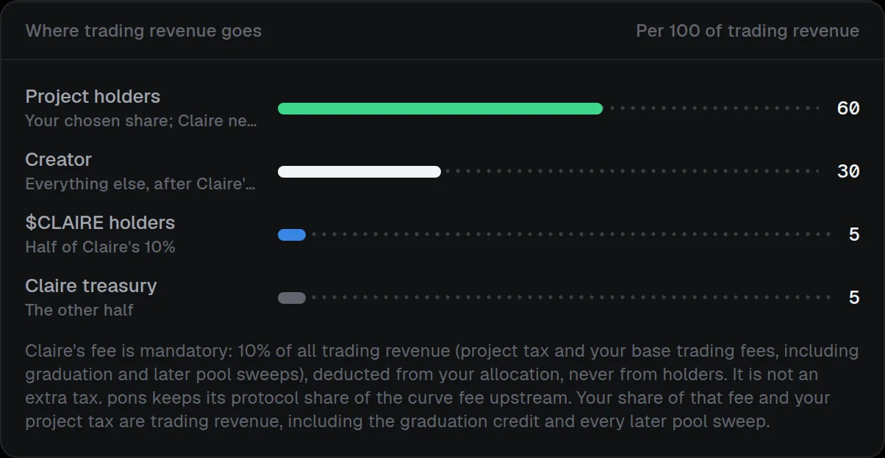

# Claire protocol fees

> [!IMPORTANT]
> None of the figures below is a promise of income or returns.

Every token launch through Claire goes through the workspace's own **fee router**. The router carries out the launch on pons v2 and becomes the token's creator-fee recipient; for a [migrated token](linking-and-migration.md#bring-a-linked-token-to-claire) it adopts the token after the creator points the fees at it. There is no fee-free launch path through Claire. Launchpad settings that keep fees flowing to the router stay available, including the quote asset, tax rate, initial buy and the buyback. The **Creator fees** page shows the router's total revenue.

## Trading revenue

**Trading revenue** is everything the router claims from the launchpad's fee escrow. That includes project tax and the creator's base trading fees, and covers curve sweeps, the graduation credit and later pool sweeps; on pons with buyback on it also includes the launch tokens the buyback vests to the router. Trading volume, upstream platform and liquidity fees, gas and anything sent straight to the router are not trading revenue and are never charged. Each payout asset is split separately and paid in that asset, with no swap:

- **Claire takes 10%** of trading revenue, deducted from the creator's share and split evenly between the Claire treasury and $CLAIRE holders.
- **Project holders** receive the share you set when you deploy the router, up to 90%. After that the launcher can only raise it, never lower it, and a raise applies to fees collected after it.
- **The payee** receives the rest, including rounding remainders: the launcher, a vesting vault or a split, as chosen at launch or changed since with 7 days' public notice.

| Per 100 units of trading revenue | Claire treasury | $CLAIRE holders | Payee (creator share) | Project holders |
| --- | --- | --- | --- | --- |
| Holder sharing off | 5 | 5 | 90 | 0 |
| Holder sharing at 50% | 5 | 5 | 40 | 50 |

## Service fees

**Service fees** are fixed amounts of one USD stablecoin per chain (USDG on Robinhood Chain), with no price oracle, so a depeg changes their real value but not the amount charged. You can pay them with ETH through the [Buy with ETH swap in the launch steps](launch.md). Each fee is split evenly between the Claire treasury and $CLAIRE holders, and is separate from gas and launchpad fees:

| Service | Claire fee |
| --- | --- |
| **Launch** | USD 10, taken by the router in the launch transaction and charged only if the launch succeeds. |
| **Migrating a linked token to Claire** | USD 25, once, paid at adoption. See [Bring a linked token to Claire](linking-and-migration.md#bring-a-linked-token-to-claire). |
| **Locking a linked token that has not migrated** | USD 25 per funding transaction, however many beneficiaries. It is never a share of the locked tokens. |
| **Locking a token launched through Claire or migrated to it** | Free apart from gas. Eligibility comes from an on-chain registry that only Claire fee routers can write, for tokens they launched or adopted themselves. Importing or naming a token does not make it eligible. |
| **Claims, unlocks, cancellations and transfers** | No Claire fee; gas still applies. |

Before you sign, Claire shows the exact payment token and amount, the launchpad's own fees and a gas estimate.

When the paying organization was referred, a referral reward comes out of Claire's treasury half of a service fee, never out of trading revenue. Projects that launched through Claire can also choose to airdrop part of their token to $CLAIRE holders. Both are described in [$CLAIRE holders and referrals](../../claire/index.md).

## Limits to keep in mind

- Project-holder payouts are distributed in rounds that the designated wallet publishes from Claire's finalized holder index; see [Payout rounds](payout-rounds.md). The contract does not check the snapshot itself: a round is only as correct as the balances it was built from, which the [verification guide](../../verification/index.md) lets you compare with the chain.
- On pons, anyone can credit a router's balance in the launchpad's fee escrow. Such a credit cannot be told apart from trading revenue, so it is split the same way.
- Launchpad administrators can change upstream settings between review and execution.
