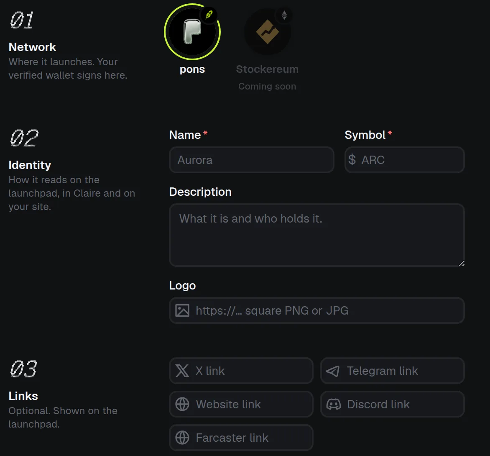
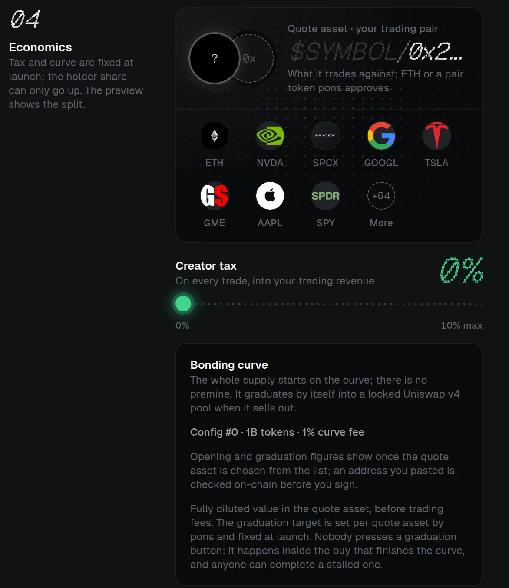
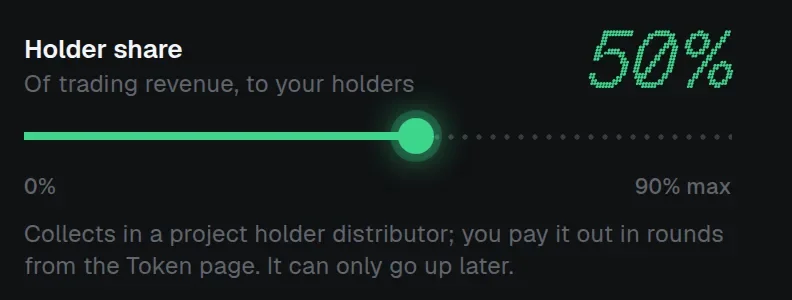
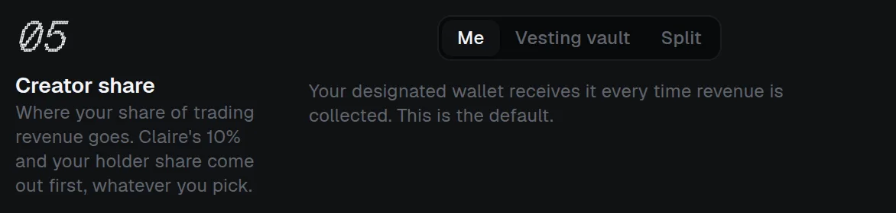
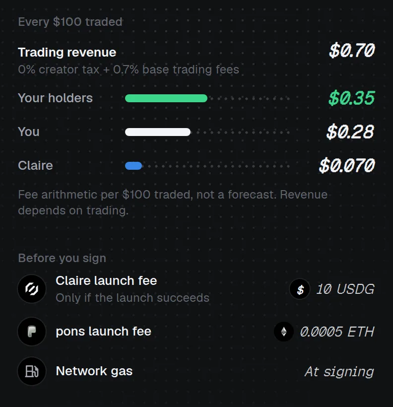
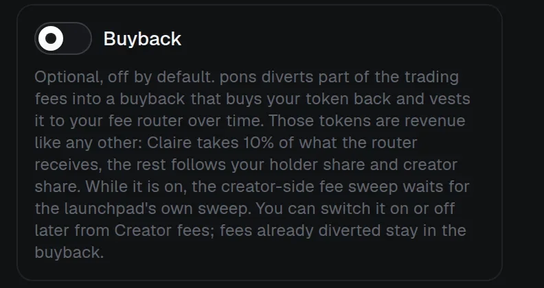

# Launch a token

Launching through Claire deploys your workspace's fee router and launches the token on Robinhood Chain (pons v2) from the [designated wallet](signing-wallet.md).

## Launch steps

:::steps

### Choose the payee

Choose who receives the creator share in **Creator share** ([see Creator share and split](creator-share-and-split.md#choose-who-is-paid)): **Me** (the designated wallet, the default), a **Vesting vault** or a **Split**. A vault or split is deployed first, from the designated wallet.

### Deploy the fee router

Deploy your workspace's **Claire fee router** from the designated wallet. Set the starting project-holder share of trading revenue when you deploy it. You can later [raise the holder share and change the creator share's recipient](creator-share-and-split.md#change-the-split-after-launch); the holder share can never go down. Each router launches one token. A router that already exists is reused only when its recipient matches the draft.

### Enter launch details

Robinhood pons v2 offers every native option: the [launch config, the quote, a creator tax, opening snipe-tax exemptions](launch.md#pons-v2-launch-options) and the [buyback](launch.md#pons-buyback). Creator fees go to your fee router. Review the live factory settings and costs. An optional initial buy, where available, spends the pair token or wallet ETH; you can also [lock the opening buy](launch.md#lock-the-opening-buy).

### Approve the fees

Approve the Claire launch fee to your fee router, and for a pons pair token also the exact initial buy. The router takes them in the launch transaction. If the designated wallet lacks the fee's stablecoin, Claire first offers **Buy with ETH**: one Uniswap swap that buys exactly the missing amount, capped at 1% above the quote, and refunds unused ETH in the same transaction.

### Launch

When the draft passes its checks, select **Launch** to walk through the signed transactions. Each one is prepared and shown for review first: the network, wallet, destination contract, calldata, ETH value, nonce, and costs. Preparing is not submission; submission is not confirmation.

### Follow each transaction

Follow each transaction in the signing wallet's **Transactions** until it is verified. If submission is uncertain, use **Check or recover** to refresh it from the chain or verify a transaction hash you know was sent.

### Check the link

A verified launch is linked automatically only if the initiating user still has owner/admin access, the wallet designation is unchanged, and no different token is linked. A confirmed transaction can remain unassociated if those checks fail; read its status instead of launching again.
:::

> [!WARNING]
> **Do not resend** an uncertain transaction or abandon it unless you know it was never sent. Confirmations reduce, but do not eliminate, reorganization risk.

Stock-linked assets, which Ethereum (coming soon) will use, involve issuer, oracle, market and securities-compliance risks. See the [Token guide](../token.md) before interpreting market or creator-fee figures.

## The launch form

The launch form is one page, saved for your team as you type. Nothing is signed there; the Token page tells you whether the draft is ready to launch. **Edit draft** goes back to any field, and **Discard draft** clears every field for your whole team without changing anything on-chain.

Choose the network, name the token and add optional links:

**Economics** sets the quote asset and the creator tax, and shows the bonding curve:

The same section sets the holder share, which can only go up later. The optional initial buy, its slippage and the opening snipe-tax exemptions follow it; see [pons v2 launch options](launch.md#pons-v2-launch-options).

**Creator share** picks the [payee](creator-share-and-split.md#choose-who-is-paid):

The preview beside the form shows the fee arithmetic per USD 100 traded and what you pay before you sign. It is arithmetic, not a forecast.

## pons v2 launch options

The launch form on Robinhood Chain offers every option pons v2 itself offers:

- **Bonding curve (launch config):** when pons enables more than one, you choose among them. Each shows its opening market cap, graduation market cap and the amount raised to graduate, in the quote you picked. The curve is constant-product, and graduation is automatic once it sells out.
- **Quote asset:** native ETH or any pair token pons currently approves. A quote such as a tokenised stock carries its own risk: it can be paused or controlled by its issuer.
- **Creator tax:** an optional percentage you set on each trade. It is part of the trading revenue the router collects, so it is split like the rest.
- **Opening snipe tax and exemptions:** pons charges a snipe tax on buys right after a launch that starts at 99% and decays within seconds, and pays it back into the trading fee. **Opening snipe-tax exemptions** takes up to 32 additional wallets (one per line or separated by commas) that are exempt; they are saved with the draft.
- **Initial buy:** optional, in the pair token or wallet ETH, with slippage protection. It can be [locked](launch.md#lock-the-opening-buy).
- **Buyback:** see [pons buyback](launch.md#pons-buyback).

The launch review repeats the launch config, the graduation threshold and both market caps, and discloses the snipe tax, the quote-asset risk and pons' admin powers.

## pons buyback

On pons, **Buyback** is off by default and is a switch at launch; the creator wallet can also turn it on or off later from **Creator fees**. When it is on:

- pons diverts part of the creator's quote fees to buy the launch token and vests it linearly over 5 years in its buyback vault. The vested tokens are credited to your fee router's escrow balance in the launch token.
- Only pons' fee-sweep operator can sweep while buyback is on, so quote revenue reaches the router after the operator has swept.
- You collect the vested tokens like any revenue, with **Collect and split** on the **Buyback** card: the router releases what has vested, claims it and splits it in launch tokens. The holder share goes to the project-holder distributor in that token (publish it with **Publish holder round**), and the payee gets the rest.
- **Claire's 10% applies to everything the router receives**, including the vested launch tokens: 10% of them, half to the treasury and half to $CLAIRE holders. The quote that pons diverts to the buyback never reaches the router, so it is never charged. Per unit of diverted fee, Claire earns less than without buyback, in launch tokens, over years.

## Lock the opening buy

A launch can lock its opening buy. In the launch form, turn on the **Lock the opening buy** switch. It is off by default and appears only once you enter an initial buy. Off means a normal launch, where the bought tokens go straight to the designated wallet, exactly as described above.

With the switch on, choose a schedule in UTC (**Timelock**, **Linear** or **Cliff + linear**, as in [Fund a vesting allocation](vesting-and-locks.md#fund-a-vesting-allocation)) and whether the beneficiary can be transferred. The launch review lists the lock, and the fee router does the rest inside the launch transaction:

1. The router receives the bought tokens instead of the creator wallet and pays the launch fee. This registers the token as launched through Claire, which is why locking it costs nothing.
2. It locks **all** bought tokens for the creator in the [Claire token lock](../../protocol/locks.md#clairetokenlock) on that schedule.
3. Unspent pair token or ETH is still returned to the creator wallet.

The lock is **never cancelable** by anyone, because the router that funds it has no way to cancel. Only transferability is chosen, and only at launch. There is no Claire lock fee on top of the launch fee. Claims are permissionless and pay only the creator, as for any lock. Once the launch confirms, the lock appears with your other locks, funded by the router, and you can publish it like any other. The router emits `OpeningBuyLocked(token, lockId, amount)`, so the lock can be [verified](../../verification/locks.md#verify-a-lock) like any other.

## Next steps

:::cards
::card[Creator share and split]{href=creator-share-and-split.md icon=users}
Choose who is paid and change the split later.
::card[Claire protocol fees]{href=fees.md icon=receipt}
What the launch costs and how trading revenue is split.
:::
