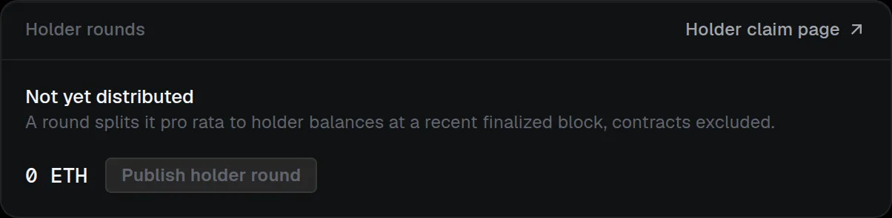

# Payout rounds

Project-holder distributions, $CLAIRE holder distributions, airdrops and referral rewards all use the same cumulative rounds.

## How rounds work

- **Cumulative:** each round publishes a new root for one asset in which every account's entry is its running total. A claim pays what you are owed minus what you already received, so **Claim everything owed** collects every round for an asset in one transaction, whenever you like. Rounds still publish on their schedule; a missed claim loses nothing, except on an expiring airdrop.
- **Funded or from held funds:** a round that has funds to share (project holders, $CLAIRE holders) publishes over what the distributor already holds; airdrop and referral rounds fund the increase and publish in one transaction. A round can never promise more than the distributor holds.
- **Airdrop expiry:** an airdrop distributor is deployed with a **Claims close (UTC)** date (at least 7 days out; the default is 90). Claims close at that date and the designated wallet can **Reclaim unclaimed tokens**. The airdrop page, its public proof and the claim page state the date.
- **Manifest (version 1):** every round has a manifest that lists every account's amount for this round and its cumulative total and chains to the previous round's manifest. Its keccak-256 is the round's on-chain evidence, so [anyone can verify](../../verification/rounds-and-manifest.md#the-round-manifest) the amounts, the continuity between rounds and the completeness of the holder list.

## Claim a payout

Holders claim at `/distributions/<chainId>/<distributor>`; the claim page shows each asset's rounds, what is promised in total and claimed, and what each connected wallet is owed.

## Publish a holder round

The **Holder rounds** card on **Creator fees** shows what is not yet distributed and is where the designated wallet publishes a round.

