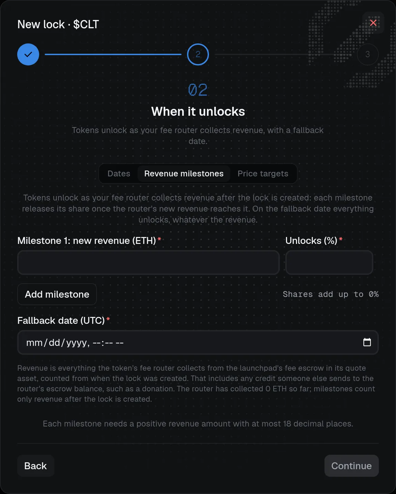

# Revenue and price locks

Besides date-based locks, a token launched through Claire can lock tokens that release in tranches as revenue or price milestones are reached. Both need the [protocol](fees.md) and are funded from [Vesting](vesting-and-locks.md#fund-a-vesting-allocation).

## Revenue locks

A **revenue lock** holds tokens of a token launched through Claire and releases them in tranches as that token's own trading revenue grows, instead of by date alone. Like every Claire lock, it needs the [protocol](fees.md) to be deployed.

In **Vesting → New lock**, **Unlock by** offers **Dates** or **Revenue milestones**. Revenue milestones appear only for a token launched through Claire whose fee router is set up. Choosing them replaces the schedule step, and the Options step is skipped because the lock is always noncancelable and nontransferable.

- **Milestones:** 1 to 10 rows, each a threshold of new router revenue, entered in the quote asset's own units, and an **Unlocks %** share. Thresholds strictly increase and the shares must add up to 100%. The dialog also shows the router's revenue so far.
- **Baseline:** thresholds are measured from the router's cumulative revenue at the moment the lock is created, so revenue earned earlier never counts.
- **Fallback date:** mandatory, in UTC and in the future. From that date on, everything is unlocked whatever the revenue.
- **Unlocked amount:** the lock amount times the summed shares of the milestones reached, rounded down; everything from the fallback date.
- **Beneficiaries:** up to 100 per funding transaction, all on the same milestones and fallback date.
- **Rules:** only tokens launched through Claire can be locked, there is no Claire fee, and a lock can be neither canceled nor transferred. Anyone can submit a claim, and the tokens go only to the beneficiary.
- **Proof and claims:** the public proof page is `/locks/<chainId>/revenue-<lockId>` and the claim page is `/vesting/<chainId>/revenue-<lockId>`, next to `claire-<lockId>` for date-based locks. The proof page shows revenue since the lock was created against its milestones and the fallback date; the locks table reads **Revenue milestones · fallback date**.

> [!NOTE]
> **What counts as revenue.** Revenue is the cumulative total the fee router collects from the launchpad's fee escrow, not only the creator's or the non-refundable share, and it includes deliberate third-party credits to the router's escrow balance. A credit cannot be told apart from trading revenue on-chain, so anyone willing to pay can bring milestones forward. The fallback date still bounds every lock.

Fee-on-transfer and rebasing tokens are rejected at funding. See the [contract reference](../../protocol/locks.md#clairerevenuelock) and [Verify on-chain](../../verification/revenue-and-price-locks.md#verify-a-revenue-lock) to check a lock yourself.

## Price-target locks

A **price-target lock** holds tokens of a token launched through Claire and releases them in tranches as the token's market price holds above targets. It needs the [protocol](fees.md) like every Claire lock.

In **Vesting → New lock**, **Unlock by** offers **Dates**, **Revenue milestones** or **Price targets**. Price targets appear only for a token launched through Claire. The Options step is skipped: the lock is always noncancelable and nontransferable.

- **Targets:** 1 to 10 rows, each a price per token in the quote asset (not in USD) and an **Unlocks %** share. Prices strictly increase, the shares add up to 100%, and the first target must be above the highest price the token has already sustained.
- **Fallback date:** mandatory, in UTC and in the future. From that date everything is unlocked whatever the price.
- **Beneficiaries:** up to 100 per funding transaction, all on the same targets and fallback date.
- **Rules:** only tokens launched through Claire can be locked, there is no Claire fee, and a lock can be neither canceled nor transferred.

**How a target is reached.** The price is sampled on-chain whenever anyone updates it. Each hour keeps its lowest sample, and a target is reached once the lowest hourly value over the last **24 completed hours** is at or above it. Only completed hours count, and every one of the 24 needs at least one sample. Once reached, a target stays unlocked for good.

**Anyone can update the price.** The public **Update price** link on lock cards and the claim page prepares the update; any wallet can send it, with only gas to pay, and no project is needed. A later update in the same hour lowers that hour's minimum if the price is lower, so an update at the real price corrects an inflated sample. The price comes from the launchpad: before graduation pons' bonding curve, after graduation the Uniswap v4 pool pons registered for the token.

> [!WARNING]
> **A sampled-price trigger, not an oracle.** The price is a spot read. A trader who can move the market for one transaction can raise the price, update it and unwind, and an hour with no honest update can carry that manipulated sample. Nothing forces anyone to update the price. Moving the price costs the capital the trade needs plus round-trip fees, repeated for each of the 24 hours, but set targets with this in mind: only the fallback date guarantees an unlock.

The proof page shows the highest price held for 24 hours against each target and its share, the last sample and its age, the window's lowest sample and the fallback date. The tokens move only through the lock's `claim`, which pays the beneficiary. See the [contract reference](../../protocol/locks.md#clairepricelock) and [Verify on-chain](../../verification/revenue-and-price-locks.md#verify-a-price-lock) to check a lock yourself.
