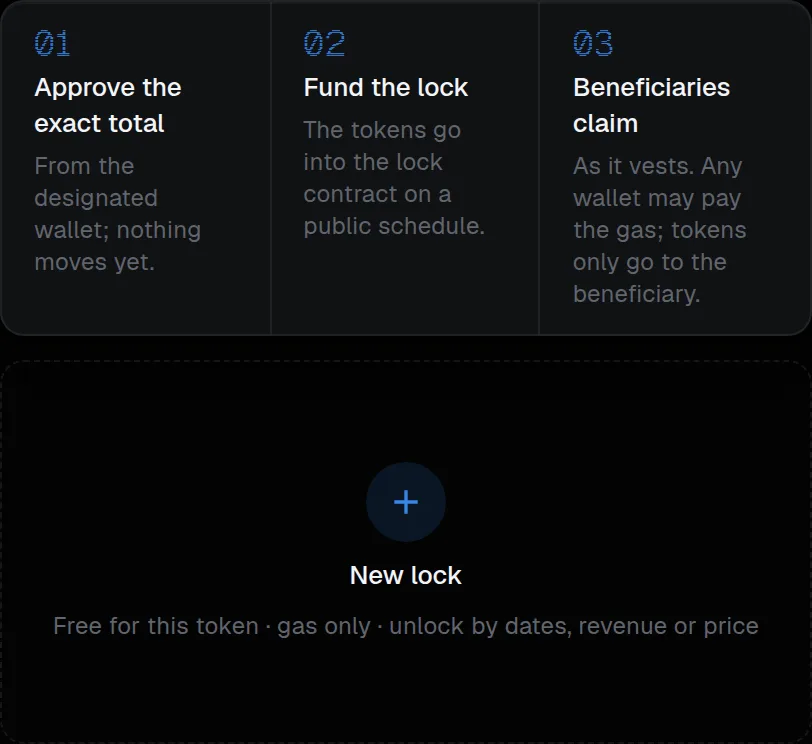
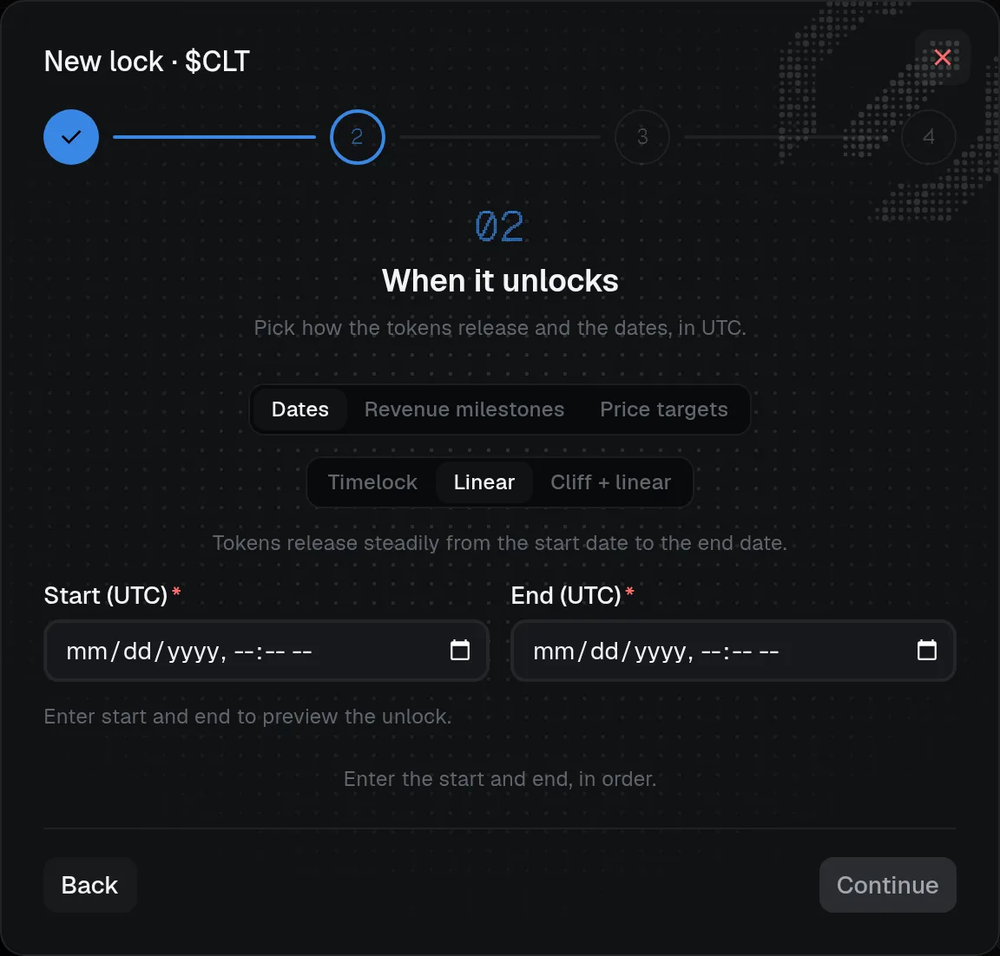

# Vesting and locks

Lock tokens for beneficiaries on a schedule, then publish the proof and let them claim. To unlock by revenue or price instead of dates, see [Revenue and price locks](revenue-and-price-locks.md).

## Fund a vesting allocation

Vesting requires a linked supported pons v2 token. In **Vesting**, **New lock** opens a step-by-step dialog: enter the beneficiaries, exact token amounts, and UTC schedule. A **Claire token lock** holds one or many beneficiaries on one schedule:

- **Timelock:** the full amount becomes claimable at the end.
- **Linear:** tokens become claimable progressively between start and end.
- **Catch-up cliff:** nothing is claimable before the cliff; the fraction accrued since the start unlocks at the cliff, then vesting continues linearly.

The dialog's first step takes the beneficiaries and amounts; the second sets when the tokens unlock:

## Choose how a lock unlocks

| Unlock by | Available for | Claire fee | Cancel and transfer |
| --- | --- | --- | --- |
| **Dates** | A linked supported pons v2 token | Free apart from gas for a token launched through Claire or migrated to it; USD 25 per funding transaction otherwise | Noncancelable and nontransferable by default; you can turn either on at creation |
| [**Revenue milestones**](revenue-and-price-locks.md#revenue-locks) | A token launched through Claire whose fee router is set up | None | Never |
| [**Price targets**](revenue-and-price-locks.md#price-target-locks) | A token launched through Claire | None | Never |

## Cancellation and transfer

A lock is **noncancelable and nontransferable** by default. You can turn on cancellation or beneficiary transfer at creation, before funding. Under **Cancelable** you can add a **Notice period (days)**: the funder must first select **Request cancel**, which starts a public countdown, and can select **Cancel** only after it ends (with no notice, **Cancel lock** works at once). The beneficiary keeps vesting and can claim during the notice, and the refund is computed when the cancellation executes. Verify the beneficiaries, amounts, and dates carefully before funding.

## Sign and fund

:::steps

### Approve the token

Prepare and sign the exact ERC-20 approval from the designated wallet, unless sufficient allowance is already available. Approval grants the lock contract an allowance; it does not fund a lock. For a token launched elsewhere, also approve the Claire lock fee; if the wallet lacks the fee's stablecoin, buy it with ETH first, as for the launch fee. Wait for confirmation.

### Fund the lock

Separately prepare, review, sign, and confirm the funding transaction, which deposits the tokens into the lock contract.

### Check the outcome

Check the recorded outcome. Approval and funding each need gas. Review the destination, calldata, value, and nonce each time, and use the same recovery procedure if submission is uncertain.
:::

## Publish proof and claim payouts

After funding is verified and associated with the workspace, an owner or admin can **Publish** the lock. The token's Claire Proof page lists it and links to `/locks/<chainId>/claire-<lockId>` (`revenue-<lockId>` for a revenue lock, `price-<lockId>` for a price lock), where anyone can inspect the beneficiary, schedule, contract, funding transaction, and on-chain locked, claimable, and withdrawn amounts. A cancelable lock with a notice shows **Funder can cancel after a N-day notice**, then the date once a cancellation is requested.

This is evidence of a particular allocation, **not** an endorsement, payout guarantee, or liquidity lock. Unpublishing removes Claire's public listing/proof access; it does not hide on-chain addresses, transfers, or schedules.

Beneficiaries claim at `/vesting/<chainId>/claire-<lockId>` (`revenue-<lockId>` or `price-<lockId>` for those lock types): a signed-in user can connect a wallet and prepare a payout claim without joining the organization. Anyone may submit and pay the network gas, or call `claim` on the lock contract directly, but tokens go only to the beneficiary recorded on-chain. The claim pays what is available when it executes; the displayed amount may change. Claims have no Claire fee.

Vesting with time alone does not send tokens automatically. Check the transaction outcome before relying on a payout. These beneficiary payouts are distinct from [creator-fee figures](../token.md#read-creator-fee-figures), which remain read-only in Claire.
